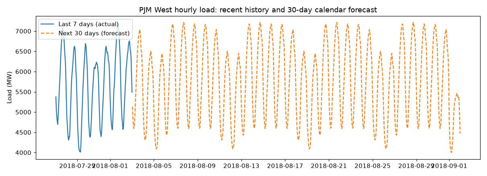

# Hourly Energy Consumption Forecast

Exploratory analysis and a calendar-based forecast of hourly electricity load for the **PJM West** region (143,206 hourly readings, April 2002 to August 2018).



## Results

Train on 2002-2017, test on the held-out 2018 data (Jan to Aug, 5,136 hours, mean load 5,848 MW):

| Model | MAE (MW) | RMSE (MW) |
|---|---|---|
| Average for the same month / weekday / hour (baseline) | 510.9 | 685.5 |
| Random Forest on calendar features | 510.9 | 685.4 |

**What this tells us:** the load is explained almost entirely by the calendar (daily cycle, weekday vs weekend, season). The Random Forest only reproduces that seasonal profile, so it adds nothing over a lookup table; both are off by about 8.7% of the average load. Beating this needs information the calendar does not carry, mainly weather (temperature) and holidays.

An earlier version of this project included `year` as a feature. A tree model cannot extrapolate to a year it has not seen, and it made the test error worse (MAE 552 MW vs 511 MW), so it was removed.

## Run it

```bash
pip install -r requirements.txt
python src/train.py                  # trains, scores against the baseline, writes models/
streamlit run app/streamlit_app.py   # overview, charts and the 30-day forecast
```

Tests: `pip install -r requirements-dev.txt && pytest`

## Layout

```
data/PJMW_MW_Hourly.xlsx   source data (PJM West hourly load, MW)
src/features.py            calendar features
src/train.py               training + evaluation against the baseline
app/streamlit_app.py       dashboard
notebooks/                 original exploration notebook (Colab export)
models/metrics.json        scores from the last run
```

## Limitations and next steps

- Calendar-only features: no weather, no holidays.
- Only 7 months of test data (Jan to Aug 2018), so seasonal error is not fully covered.
- Next: add temperature and a US-holiday calendar, then compare gradient boosting against the same baseline.

Data: PJM Interconnection hourly energy consumption (public).
